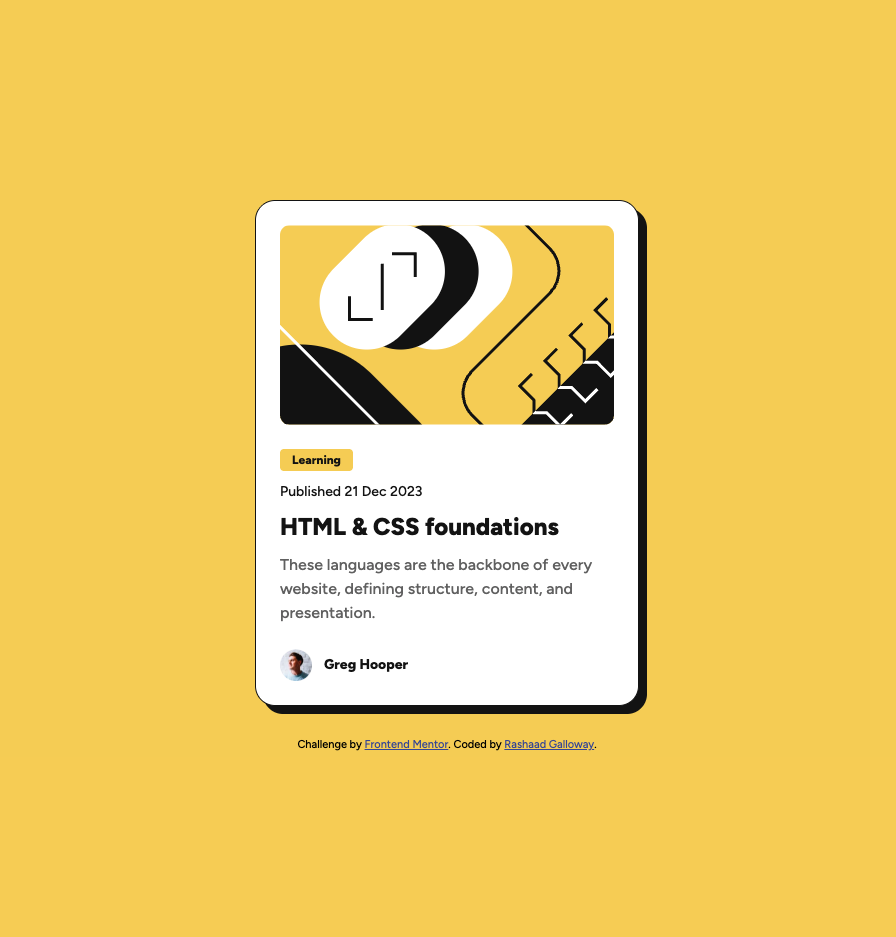

# Frontend Mentor - Blog preview card solution

This is a solution to the [Blog preview card challenge on Frontend Mentor](https://www.frontendmentor.io/challenges/blog-preview-card-ckPaj01IcS). Built as a lab for the Per Scholas full-stack program.

## Table of contents

- [Overview](#overview)
  - [The challenge](#the-challenge)
  - [Screenshot](#screenshot)
  - [Links](#links)
- [My process](#my-process)
  - [Built with](#built-with)
  - [What I learned](#what-i-learned)
  - [Useful resources](#useful-resources)
  - [AI Collaboration](#ai-collaboration)
- [Author](#author)

## Overview

### The challenge

All users should be able to:

- See hover and focus states for all interactive elements on the page

### Screenshot

### Links

- Solution URL: [GitHub repo](https://github.com/mrg-repo/preview-card-frontendmentor)
- Live Site URL: [GitHub Pages](https://mrg-repo.github.io/preview-card-frontendmentor/) 

## My process
I started with the HTML formatting and then transitioned to CSS with general styling coming first and more specific styling traits coming after. 

### Built with

- Semantic HTML5 markup (`main`, `article`, `h1`, `footer`)
- CSS Flexbox
- CSS media query for mobile font sizes
- Google Fonts (Figtree)
- Measurements taken from the design JPGs (1 image pixel = 1 CSS pixel)

### What I learned

**Hover and focus states.** A pseudo-class styles an element only while it's in a certain state. 

Putting `transition` on the normal state (not the hover state) makes the color fade both in and out.

**Margins don't merge inside flexbox.** Stacked paragraphs normally share their margins, but inside a flex container the margins add up. I gave every element a bottom margin only, so gaps never doubled.

**Media queries.** `@media (max-width: 480px)` switches to smaller font sizes on phones, and it has to come last in the file so it overrides the desktop sizes.

**`width: fit-content`** shrinks the "Learning" tag to the size of its text instead of stretching across the card.

### Useful resources

- [MDN: :hover](https://developer.mozilla.org/en-US/docs/Web/CSS/:hover) - How hover states work
- [MDN: :focus](https://developer.mozilla.org/en-US/docs/Web/CSS/:focus) - Focus states for keyboard users
- [MDN: Using media queries](https://developer.mozilla.org/en-US/docs/Web/CSS/CSS_media_queries/Using_media_queries) - How media queries work
- [CSS-Tricks: A Complete Guide to Flexbox](https://css-tricks.com/snippets/css/a-guide-to-flexbox/) - Visual flexbox reference

### AI Collaboration

I used Claude to help me with CSS box model specifics related to sizing and spacing.   

## Author

- GitHub - [MRG-REPO](https://github.com/mrg-repo)
